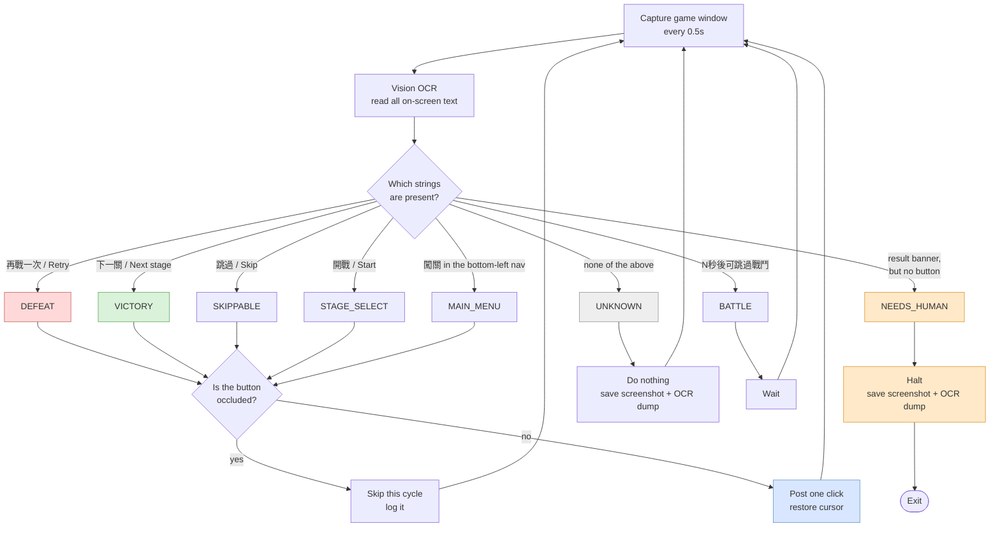

# wild-water-world-autoplay

Automates the repetitive stage-grinding loop in **Wild Water World**
(瘋狂水世界) on macOS: skip the battle animation, retry on defeat, advance on
victory — over and over, without you sitting there clicking.

It works the same way a person does: it reads the text on screen and clicks
buttons. No game files are modified, no network traffic is intercepted, no
process memory is touched.

繁體中文說明：**[README.zh-TW.md](README.zh-TW.md)**

> **This is not a cheat.** It gives you nothing the game would not already
> give you, does not speed up combat, and does not change drop rates or win
> probability. It presses the same buttons you would press yourself.

---

## Who this is for

Built specifically for **Wild Water World**'s stage-grinding loop: the same
screens come around again and again — **Skip → retry on defeat → next stage on
victory → Start battle** — and the bot presses those buttons for you. It is not
a generic auto-clicker; on any game or screen it does not recognise it does
nothing.

**Before you start, make sure:**

| Condition | Notes |
|---|---|
| The game runs in a **window** on this Mac | Window title contains「水世界」. Not minimised, and not covered by other windows (when covered it can still see the button but will not click) |
| The game UI language is **Chinese** | It recognises the on-screen text 再戰一次 / 下一關 / 跳過 / 開戰, in Traditional or Simplified. Other languages will not work |
| You are on the **main screen**, the **stage screen** (the 開戰 button) or mid-battle | From the main screen it taps 闖關 in the bottom-left nav itself; starting on a result screen also works |
| Your team, stamina and resources are ready | It does not change teams, refill stamina or touch the shop |

On a screen it does not recognise (pop-ups, events, purchase screens, story
choices) it **does nothing and waits for you**. Return to one of the screens
above and it carries on by itself.

## Requirements

- macOS 13 (Ventura) or later, Apple Silicon or Intel
- Wild Water World running in a window on the same Mac
- No Python or developer tools required — the installer provides them

OCR runs entirely on-device through Apple's Vision framework. Nothing is
uploaded and no model needs downloading.

## Installation

```bash
git clone https://github.com/livejiaquan/wild-water-world-autoplay.git
cd wild-water-world-autoplay
./install.command
```

Or, for non-technical users: download the ZIP, unpack it, and double-click
`install.command`.

The installer detects whether a usable Python is present and, if not,
provisions a self-contained one via [uv](https://github.com/astral-sh/uv).
Neither an administrator password nor Xcode Command Line Tools are needed.

### Granting permissions

Two macOS privacy permissions must be granted **to the terminal application**
that runs the script:

| Permission | Why |
|---|---|
| **Screen Recording** | Reads the game window's pixels. Without it the bot is blind. |
| **Accessibility** | Posts the click events. Without it the bot cannot act. |

`install.command` opens the relevant System Settings panes automatically.
**Quit and reopen the terminal afterwards** — macOS only applies these
permissions to newly launched processes.

Verify at any time:

```bash
./check.command
```

## Usage

```bash
./start.command                 # run
```

Stop with `Control-C`, or by creating a `STOP` file in the project root.

<details>
<summary>Command-line options</summary>

```bash
python3 waterbot/bot.py --check                   # environment and permissions
python3 waterbot/bot.py --list                    # list candidate windows
python3 waterbot/bot.py --dry-run                 # classify only, never click
python3 waterbot/bot.py --app 水世界               # window-title keyword
python3 waterbot/bot.py --interval 0.5            # seconds between frames
python3 waterbot/bot.py --stop-after-stage 900    # stop at a given stage
python3 waterbot/bot.py --max-stuck 300           # give up after N idle seconds
python3 waterbot/bot.py --max-clicks-per-min 20   # runaway brake
```
</details>

**Run `--dry-run` first.** It prints what it would click without clicking,
which is the cheapest way to confirm the detector is reading your build of the
game correctly.

## How it works



The bot uses the in-game *Skip* button rather than watching the full battle.
Cycle time depends mainly on how long until Skip becomes available; after a
click it does not wait a fixed delay but re-checks every 0.2 s and moves on the
moment the screen changes.

### Detection is text-based, and keys off buttons

Matching on text rather than image templates means the detector survives art
changes, and click targets come from the OCR-reported position, so window
resizing and display scaling are irrelevant.

Crucially, **buttons are the signal, not banners**. Result-screen banners use a
decorative typeface that OCR frequently mangles — `挑戰勝利` ("Victory") has
been observed decoding as `挑郫膀朻`, three characters wrong out of four —
while the `下一關` button on the same frame reads at confidence 1.00.

Matching strips trailing digits — the button legend is really `下一關(4)`, with
an auto-advance countdown — but is otherwise **exact against an explicit list of
known OCR variants**, with a tight length bound.

Fuzzy matching was tried and removed. Tolerating a single wrong character is
catastrophic for short keys: `城战`, `甙战` and `提战` all matched `开战`, twice
on a ¥648 purchase screen. Three-character keys are no safer, because
`下一页` and `下一级` are real words one character away from `下一關`. An
unrecognised misreading now falls through to `UNKNOWN`, where it is logged
with its OCR dump so the variant can be added deliberately. Missing a click
is cheap; a wrong click is not.

### Capture reads a window; clicks hit the screen

These are different mechanisms, and the asymmetry matters.

| | Mechanism | When the game is behind another window |
|---|---|---|
| **Capture** | `CGWindowListCreateImage` with `kCGWindowListOptionIncludingWindow` | Unaffected — the compositor keeps a per-window layer |
| **Click** | `CGEventPost` in global screen coordinates | **Lands on the window on top** |

So the bot can see a button it cannot click. Every click is therefore preceded
by an occlusion check (`covered_by()`); if anything overlaps the target point,
that cycle is skipped and logged.

> **In practice:** place the game window where your other windows will not
> cover it. Occluded, the bot is safe but idle.

`CGEventPostToPid`, which would avoid moving the cursor at all, was tested and
**does not deliver mouse events** on current macOS, foreground or background.
The global path is used instead, with the cursor warped back immediately
afterwards. Usefully, this does not raise the game window, so keyboard focus
stays with whatever you are using.

### Impact while running

Keyboard focus is never taken. The only interruption is the cursor jumping to
the button and back — about **150 ms, once per button press**. CPU use is
roughly 20% of one core.

## Safety behaviour

The game has an in-app purchase interface, so the bot is built to stop rather
than guess:

- **Unrecognised screens are never clicked** — screenshot and OCR dump only.
- **A result screen whose button cannot be read is waited out, not guessed.** On
  the victory screen *Back* and *Next stage* sit on the same row about 180 px
  apart, so a guessed coordinate could exit the stage instead of advancing.
  A story dialogue can briefly cover the button, so the bot waits and retries;
  the stuck-screen timeout ends the run if it never clears.
- **Occluded buttons are not clicked.**
- Automatic stop after 20 clicks in a minute (runaway detection).
- Automatic stop after 5 minutes on an unchanging screen.
- Automatic stop if the game window disappears.

## Progress record

Some stages take a long time, so each clear is appended to
`waterbot/out/通關紀錄.txt`:

```
關卡    通過時間            花了多久    試了幾次
────────────────────────
876     10/20 22:15:41      4分12秒     18 次
877     10/20 22:22:11      6分30秒     27 次
```

A clear is recognised by the **stage number increasing**, not by the victory
screen: the victory screen does not always render the stage number legibly,
while every battle frame carries it.

## Diagnostics

Everything lands in `waterbot/out/`:

| File | Contents |
|---|---|
| `通關紀錄.txt` | **The one meant for people**: which stage, when it was cleared, how long it took, how many attempts |
| `run.log` | Chronological log. **Unrecognised screens dump every OCR string with its position and confidence.** |
| `run.csv` | One row per action, openable in Numbers or Excel |
| `shots/` | Screenshots captured when confused or stuck |

This is deliberately verbose so a failure can be diagnosed after the fact,
by someone who was not present. When reporting an issue, attach the tail of
`run.log` together with the matching image from `shots/`.

## Testing

All test material is captured from real gameplay; none of it is synthetic.

```bash
./waterbot/.venv/bin/python tests/test_detect.py                 # 7 regression cases
./waterbot/.venv/bin/python waterbot/replay_test.py <video> 0.5  # replay a recording
./waterbot/.venv/bin/python waterbot/scan_videos.py <dir> 3.0    # mine footage for unknown screens
```

`replay_test.py` feeds a screen recording through the detector frame by frame,
which makes the whole pipeline testable without the game running.
`scan_videos.py` mines footage for screens the detector does not yet handle.
`audit.py` goes further: it classifies sampled frames, draws the intended click
target on each, and lays them out as labelled contact sheets per state, so the
verdicts can be checked by eye rather than taken on trust.

Roughly 100 minutes of public footage was mined first, surfacing three defects
that would each have stalled the loop:

| Finding | Consequence if unfixed |
|---|---|
| The victory banner reads `挑戰勝利`, not `戰鬥勝利` | Victory never recognised |
| The button legend is `下一關(4)` with a countdown | Trailing digits broke matching |
| The banner frequently OCRs as `挑郫膀朻` | Unrecognisable; fixed by keying off the button |

A second pass over four further videos (1,048 sampled frames, visually audited)
found three more, two of them dangerous:

| Finding | Consequence if unfixed |
|---|---|
| `城战` / `甙战` / `提战` matched `开战` | **Clicking a ¥648 purchase screen** |
| `下一页` / `下一级` matched `下一關` | **Clicking an event-promo popup** |
| A story dialogue briefly covered the retry button | The run halted; the screen cleared 10s later |

After the fixes, the audited verdicts were: victory 10/10, stage-select 8/8,
skip 3/3, defeat 3/3 correct, with no missed actionable screen in the sampled
`UNKNOWN` frames.

Against the author's own 2-minute recording (stage 876, eight consecutive
defeats, 936×1618), the detector classified 242 frames with no
misclassification.

### Known limitations

1. **Only tested on the author's own setup** (where it runs stably). On a
   different machine, resolution or game version, run with `--dry-run` first
   to confirm the click targets are right.
2. **Game updates** that change wording or layout will require updating the
   keyword tables, which are collected at the top of `waterbot/detect.py`.

## Project layout

| Path | Purpose |
|---|---|
| `waterbot/bot.py` | Main loop and safety brakes |
| `waterbot/detect.py` | Screen classification — **keyword tables live here** |
| `waterbot/ocr.py` | Vision framework wrapper |
| `waterbot/winio.py` | Window discovery, capture, clicking, occlusion checks |
| `waterbot/runlog.py` | Logging |
| `waterbot/preflight.py` | Environment and permission self-check |
| `waterbot/replay_test.py` | Offline replay against a recording |
| `waterbot/scan_videos.py` | Footage mining for unhandled screens |
| `waterbot/audit.py` | Classify footage and render contact sheets for visual audit |
| `waterbot/probe_frames.py` | OCR dump for a single image |
| `tests/` | Regression suite and real-screen fixtures |

## Contributing

Issues and pull requests are welcome. If you are reporting a screen the bot
fails on, please attach the relevant `shots/` image and the corresponding
`run.log` excerpt — the OCR dump is usually enough to identify the fix.

If you are adding support for a new screen, add a fixture to `tests/fixtures/`
and a case to `tests/test_detect.py` alongside the change.

## License

[MIT](LICENSE)
