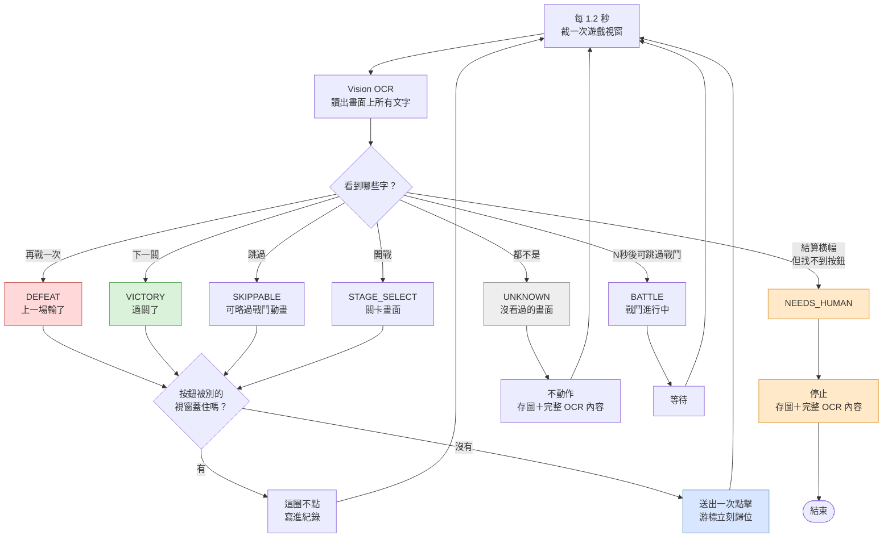

# wild-water-world-autoplay

讓《瘋狂水世界》在 Mac 上自己重複刷關：該跳過就跳過、輸了再戰一次、
贏了進下一關，一直往下刷。

它的做法跟人一樣——**讀螢幕上的字，然後點按鈕**。不改遊戲檔案、不攔封包、
不碰記憶體。

English: **[README.md](README.md)**

> **這不是外掛。** 它不會給你遊戲裡拿不到的東西，不會加快戰鬥速度，
> 也不會改變掉寶或勝率。它只是替你按那幾顆你本來就要按的按鈕。

---

## 快速開始

不懂程式也沒關係，三步都用滑鼠：

| 步驟 | 做什麼 |
|---|---|
| 1 | 雙擊 **`install.command`**，自動裝好需要的東西，約幾分鐘 |
| 2 | 照畫面指示給兩個權限，然後**把終端機視窗整個關掉重開** |
| 3 | 打開遊戲，雙擊 **`start.command`** |

停止：按 `Control + C`，或直接關掉視窗。

哪裡怪怪的就雙擊 **`check.command`**，它會說明哪裡不對、該怎麼辦。

<details>
<summary><b>出現「檔案已損毀，無法打開」？</b></summary>

從網路下載的 ZIP 會被 macOS 鎖住。在 `install.command` 上**按右鍵 → 打開**，
再按一次「打開」即可，只需做這一次。用 `git clone` 下載則不會有這個問題。
</details>

<details>
<summary><b>那兩個權限是什麼？</b></summary>

| 權限 | 用途 |
|---|---|
| **螢幕錄影** | 讓程式「看得到」遊戲畫面。沒有它完全不能用。 |
| **輔助使用** | 讓程式「點得下去」。沒有它只能看不能動。 |

權限是給**終端機**，不是給遊戲。名字聽起來嚇人，但程式只讀遊戲那一個視窗，
沒有錄影也沒有上傳。給完一定要**把終端機關掉重開**才生效。
</details>

## 系統需求

- macOS 13 (Ventura) 以上，Apple Silicon 或 Intel 都可以
- 遊戲在同一台 Mac 上以視窗執行
- **不需要**事先安裝 Python 或任何開發工具，安裝腳本會處理

文字辨識全部在本機跑，用的是 macOS 內建的 Vision 框架，不連網、不下載模型。

## 它是怎麼判斷的



一輪約 13–15 秒，大約**每分鐘刷 4 關**——因為它會按遊戲內建的「跳過」，
不用等整場戰鬥演完。

### 為什麼看文字，而且以按鈕為準

用文字判斷，遊戲改版換美術也不會壞；按鈕位置直接用 OCR 讀到的真實座標，
所以視窗縮放、換螢幕都沒差。

重點是**以按鈕為準，不是標題橫幅**。結算畫面的大標題是裝飾字體，
OCR 常整個讀爛——實測看過「挑戰勝利」被讀成「挑郫膀朻」，四個字錯三個——
但同一張畫面上的「下一關」按鈕信心值是 1.00。

比對會去掉尾端數字（按鈕實際上是「下一關(4)」帶自動倒數），
但除此之外是**對照一份明確的已知誤認清單做精確比對**，並卡死長度上限。

模糊比對試過，然後拿掉了。「容許一個錯字」用在短關鍵字上是災難：
「城战」「甙战」「提战」全被當成「开战」，其中兩次發生在 648 元的儲值畫面上。
三個字也不安全——「下一页」「下一级」都是真實詞彙，跟「下一關」只差最後一個字。
現在沒見過的誤認會落到 UNKNOWN，連同 OCR 內容寫進 log，再決定要不要補進清單。
漏點的代價很小，點錯的代價很大。

### 看的是視窗，點的是螢幕

這兩件事走**不同機制**，理解這點才知道它什麼時候會失效。

| | 用什麼 | 遊戲被其他視窗蓋住時 |
|---|---|---|
| **看畫面** | `CGWindowListCreateImage` 取單一視窗圖層 | 照樣看得一清二楚 |
| **點按鈕** | `CGEventPost` 全域螢幕座標 | **會打在蓋住它的 App 上** |

所以它可能「看得到卻點不到」。因此每次點之前都會先做遮擋檢查
（`covered_by()`），被蓋住就這圈不點並寫進紀錄。

> **實務上**：把遊戲視窗放在不會被其他視窗壓到的位置。被壓住它不會亂點，
> 但也刷不動。

原本想用 `CGEventPostToPid` 直接投遞給遊戲行程，游標就完全不用動。
**實測無效**：現在的 macOS 不分前景背景都不接受這種滑鼠事件。
最後走全域事件再立刻把游標移回原位。意外收穫是這樣點不會把視窗帶到前景，
鍵盤焦點保住了。

### 跑起來會不會吵

**不會搶鍵盤焦點。** 唯一的干擾是游標瞬移過去點一下再彈回來，
約 **150 毫秒，每 13 秒一次**。剛好在拖曳東西時會頓一下，其他時候幾乎無感。
CPU 約吃掉一顆核心的兩成。

## 防呆設計

這遊戲有儲值介面，所以寧可停下來也不亂猜：

- **看不懂的畫面一律不點**，只存圖和完整 OCR 內容。
- **結算畫面讀不到按鈕就等，不亂猜**。勝利畫面「返回」和「下一關」同高、
  只差約 180 像素，猜錯就等於退出關卡。劇情對話框可能短暫蓋住按鈕，
  所以它會等待重試；真的一直卡住則由逾時機制收場。
- **按鈕被其他視窗蓋住就不點**，避免打到你正在用的 App。
- 每分鐘點超過 20 下自動停（判斷失控）。
- 同一畫面卡超過 5 分鐘自動停。
- 遊戲視窗消失就停。

## 出事了怎麼查

全部在 `waterbot/out/`：

| 檔案 | 內容 |
|---|---|
| `run.log` | 流水帳。**看不懂的畫面會把當下 OCR 讀到的每一行字、位置、信心值都記下來** |
| `run.csv` | 每個動作一列，可用 Numbers 或 Excel 開 |
| `shots/` | 看不懂或卡住時的畫面截圖 |

刻意記得很詳細，就是為了讓人不在場也查得出原因。回報問題時，
附上 `run.log` 最後幾十行和 `shots/` 裡對應的那張圖就夠了。

## 驗證程度

測試素材全部來自真實遊戲畫面，沒有合成資料。

```bash
./waterbot/.venv/bin/python tests/test_detect.py                 # 7 個回歸案例
./waterbot/.venv/bin/python waterbot/replay_test.py <錄影檔> 0.5  # 用錄影回放
./waterbot/.venv/bin/python waterbot/scan_videos.py <資料夾> 3.0  # 掃影片找沒看過的畫面
```

`replay_test.py` 把螢幕錄影逐幀餵進判斷器，所以整條流程不用開遊戲就能測。
`scan_videos.py` 用來掃影片找還沒處理到的畫面。`audit.py` 更進一步：
它判讀抽樣的每一幀、把打算點擊的位置畫成紅圈標在圖上，
再依狀態排成貼了標籤的拼圖——讓人用眼睛逐格核對，而不是相信程式自己的說法。

先掃了約 100 分鐘公開影片，找出三個會讓迴圈卡死的缺陷：

| 發現 | 不修會怎樣 |
|---|---|
| 勝利橫幅是「挑戰勝利」不是「戰鬥勝利」 | 整個勝利流程認不出來 |
| 按鈕其實是「下一關(4)」帶倒數 | 尾端數字害比對失敗 |
| 橫幅常被讀成「挑郫膀朻」 | 完全認不出；改以按鈕為準才解決 |

之後又對四支新影片做第二輪（1,048 幀抽樣，逐張目視稽核），再找出三個，其中兩個很危險：

| 發現 | 不修會怎樣 |
|---|---|
| 「城战」「甙战」「提战」比對成「开战」 | **會點到 648 元的儲值畫面** |
| 「下一页」「下一级」比對成「下一關」 | **會點到活動促銷彈窗** |
| 劇情對話框短暫蓋住「再戰一次」 | 整個執行就此停掉，其實 10 秒後就恢復了 |

修完之後的稽核結果：勝利 10/10、關卡畫面 8/8、跳過 3/3、失敗 3/3 全部正確，
抽樣的 UNKNOWN 畫面裡也沒有任何該動作卻漏掉的。

對照自己的 2 分鐘錄影（第 876 關連輸 8 次，936×1618），
242 幀判讀**零誤判**。

### 已知限制

1. **還沒在真的遊戲上跑過。** 開發用的 Mac 沒裝這個遊戲，點擊機制是在
   原生 macOS App 上驗證的。iOS App 跑在 Apple Silicon 上隔著 UIKit 轉譯層，
   第一次用請先 `--dry-run` 確認判斷正確。
2. **遊戲改版**換掉文字或版面時要更新關鍵字，都集中在
   `waterbot/detect.py` 最上面。

## 命令列選項

```bash
python3 waterbot/bot.py --check                   # 檢查環境與權限
python3 waterbot/bot.py --list                    # 列出所有視窗
python3 waterbot/bot.py --dry-run                 # 只判斷不點擊
python3 waterbot/bot.py --app 水世界               # 視窗名稱關鍵字
python3 waterbot/bot.py --interval 1.2            # 每幾秒看一次
python3 waterbot/bot.py --stop-after-stage 900    # 打到第幾關收工
python3 waterbot/bot.py --max-stuck 300           # 卡住幾秒放棄
python3 waterbot/bot.py --max-clicks-per-min 20   # 失控煞車
```

## 專案結構

| 路徑 | 作用 |
|---|---|
| `waterbot/bot.py` | 主迴圈與安全煞車 |
| `waterbot/detect.py` | 畫面判讀，**關鍵字表在這裡** |
| `waterbot/ocr.py` | Vision 框架包裝 |
| `waterbot/winio.py` | 找視窗、截圖、點擊、遮擋檢查 |
| `waterbot/runlog.py` | 紀錄 |
| `waterbot/preflight.py` | 環境與權限自我檢查 |
| `waterbot/replay_test.py` | 用錄影做離線回放 |
| `waterbot/scan_videos.py` | 掃影片找沒處理到的畫面 |
| `waterbot/audit.py` | 判讀影片並產生核對拼圖，供人目視稽核 |
| `waterbot/probe_frames.py` | 印出單張圖的 OCR 結果 |
| `tests/` | 回歸測試與真實畫面測試圖 |

## 授權

[MIT](LICENSE)
